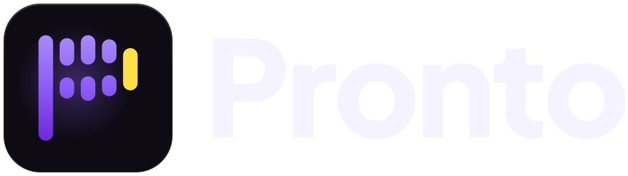
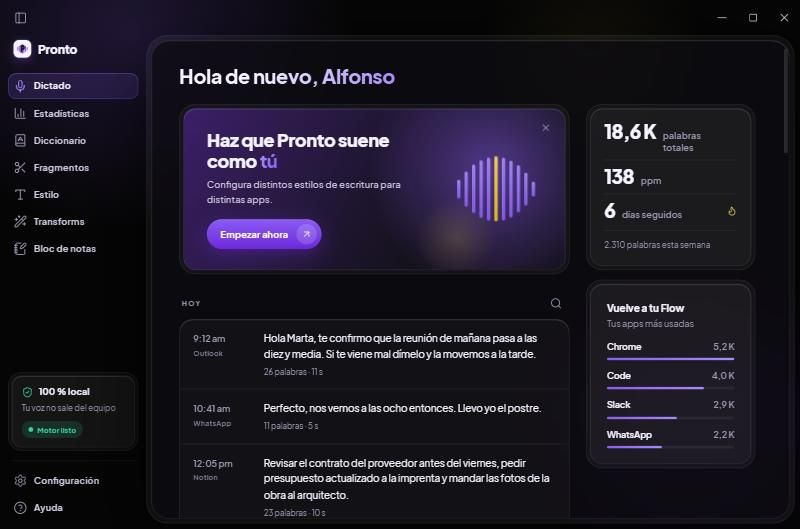

<p align="center">
  
</p>

<h3 align="center">Habla. Pronto escribe.</h3>

<p align="center">
  Dictado por voz y notas de reunión automáticas para Windows.<br>
  100 % local, escrito en Rust, sin nube, sin cuentas y sin suscripción.
</p>

<p align="center">
  <a href="https://github.com/AlfonsoGo/pronto/releases/download/v2.0.1/Pronto-Setup-2.0.1.exe"><b>⬇ Descargar Pronto 2 para Windows</b></a>
  · <a href="https://github.com/AlfonsoGo/pronto/releases/tag/v2.0.1">Notas de la versión</a>
</p>

---

Mantén `Win + Alt`, habla, suelta: el texto aparece donde tengas el cursor, en la app que sea.
Pronto 2 es la nueva versión de Pronto, reescrita desde cero en Rust (la versión anterior, en
Flutter, sigue en la rama [`v1-flutter`](https://github.com/AlfonsoGo/pronto/tree/v1-flutter)).

- **Dictado en cualquier app.** Navegador, correo, chat, editor de código.
- **Notas de reunión automáticas.** Detecta Teams, Zoom, Meet, Webex o Slack, toma notas solo y
  entrega título, resumen, tareas con responsable, decisiones y temas.
- **Polish.** Selecciona un texto, pulsa `Alt + Shift + P` y la IA local lo deja pulido.
- **Privado de verdad.** La voz y el texto no salen del equipo. Funciona sin conexión.
- **Rápido.** Motor NVIDIA Parakeet TDT 0.6B v3 (español e inglés con puntuación) en CPU: unos
  0,5 s por frase de 8 s. Ejecutable nativo de 33 MB.
- **Interfaz propia.** «Cristal etéreo»: violeta sobre negro OLED, modo oscuro y claro.



## Instalar

1. Descarga [`Pronto-Setup-2.0.1.exe`](https://github.com/AlfonsoGo/pronto/releases/download/v2.0.1/Pronto-Setup-2.0.1.exe)
   y ejecútalo. El instalador no está firmado: si Windows muestra SmartScreen, pulsa
   «Más información › Ejecutar de todas formas».
2. En el primer arranque Pronto descarga el modelo de voz (≈ 670 MB, una sola vez). Después no
   necesita Internet.
3. Opcional, IA local con [Ollama](https://ollama.com): instálalo y ejecuta
   `ollama pull qwen2.5:7b`. Sirve para pulir textos (Polish y «Pulir cada dictado»), resumir
   reuniones y responder preguntas sobre ellas. Sin Ollama, el dictado y la transcripción de
   reuniones funcionan igual; solo falta la parte de IA. Puede ir más lento según tu PC: el modelo
   usa CPU, RAM y GPU a la vez que la transcripción.

Si usas otra app de dictado que también use `Win + Alt`, ciérrala: chocan en el atajo y en la barra
de abajo al centro.

## Guía rápida: cómo se controla

### Dictar

| Quiero… | Hago… |
|---|---|
| Dictar | mantener `Win + Alt`, hablar, soltar → el texto se pega en la app con foco |
| Dictar sin mantener | doble toque de `Win + Alt`, o `Win + Alt + Espacio`; otra vez para terminar |
| Cancelar | `Esc` |
| Pegar la última transcripción | `Alt + Shift + Z` |
| Copiar la última transcripción | `Alt + Shift + X` |
| Pulir un texto seleccionado | `Alt + Shift + P` (necesita Ollama) |
| Empezar notas de reunión a mano | `Win + Alt + M` |

Un toque suelto no dicta: la barra avisa «No lo toques. Mantén pulsado Win + Alt.».

### La barra flotante

Es la píldora de abajo al centro. No roba el foco y deja pasar los clics fuera de ella. Muestra
qué está haciendo Pronto: escuchando (con la onda de tu voz), procesando, pulido, hecho, avisos de
error y el estado de la reunión («Tomando notas de Teams · Detener»).

### Notas de reunión

- **Automático** (por defecto): cuando Teams, Zoom, Meet (en el navegador), Webex o Slack empiezan
  a usar el micro, Pronto empieza a tomar notas y para solo 20 s después de colgar.
- Graba tu micro («Tú») y el audio del ordenador («Ellos») por separado y transcribe en directo.
- Al terminar genera título, resumen, tareas con responsable, decisiones y temas. Cada reunión se
  puede copiar y se puede preguntar sobre ella o sobre todas («Pregunta sobre tus reuniones»).
- Las reuniones de menos de 1 minuto sin conversación se descartan solas.
- **Configuración › Notas de reunión**: Automático · Preguntar antes · Desactivado.
- Pide siempre consentimiento antes de transcribir a otras personas.

### Cómo suena lo que escribes

- **Estilo**: tono por tipo de app (personal, trabajo, correo, otros): formal, casual, muy casual
  o entusiasta, y cuatro niveles de limpieza de muletillas.
- **Diccionario**: palabras y nombres que Pronto debe escribir siempre bien.
- **Fragmentos**: dices «mi correo» y se pega la dirección completa.
- **Transforms**: instrucciones de IA (Polish y las tuyas) sobre el texto seleccionado.
- **Pulir cada dictado con IA** (Estilo › Limpieza automática, apagado de fábrica): Ollama corrige
  puntuación y tildes antes de pegar. Añade una espera que depende de tu PC; si Ollama no responde
  en 6 s, se pega sin pulir.
- **Estadísticas**, **historial** y **Bloc de notas** en el hub.

## Privacidad

- La voz y el texto se procesan en tu equipo. No hay servidores de Pronto ni telemetría.
- Datos en `%APPDATA%\Pronto2\pronto2.db` (SQLite) y el audio de cada dictado en `audio\`, que se
  borra a los 14 días.
- La única conexión es la descarga única del modelo (Hugging Face) y, si lo usas, Ollama en
  `localhost`.

## Compilar desde el código

Requisitos: Rust estable, Windows 10/11 con WebView2.

```bash
cd src-tauri
cargo run --release          # arrancar
cargo test                   # tests
cargo install tauri-cli --version "^2" --locked
cargo tauri build            # instalador NSIS en src-tauri/target/release/bundle/nsis
```

- Backend: Rust + Tauri 2 (`src-tauri/`), captura `cpal`, motor `sherpa-onnx`, hook de teclado y
  `SendInput` con el crate `windows`, SQLite con `rusqlite`.
- Interfaz: HTML/CSS/JS sin bundler (`ui/`).
- Contrato entre backend e interfaz y decisiones: [`docs/ARQUITECTURA.md`](docs/ARQUITECTURA.md).
- Logo y animación de marca: [`docs/logo/`](docs/logo/).

## Estado

Probado de verdad en Windows 11: dictado completo, manos libres, cancelar, Polish, notas de reunión
automáticas con una videollamada simulada, resumen y preguntas con `qwen2.5:7b`. Todavía sin probar
con una reunión real de Teams o Zoom. Sin hacer: cuentas y equipos, ventana aparte de Scratchpad,
«Command Mode».

## Licencia

Código bajo [MIT](LICENSE). Plus Jakarta Sans (OFL 1.1), Lucide (ISC), sherpa-onnx (Apache-2.0) y el
modelo Parakeet TDT 0.6B v3 (CC-BY-4.0, NVIDIA) conservan sus licencias; detalle en
[`ui/assets/LICENSES.md`](ui/assets/LICENSES.md). «Pronto» y su logo son de Beltran Labs. Proyecto
independiente, sin afiliación con otras aplicaciones de dictado.

Hecho por **Beltran Labs**.
